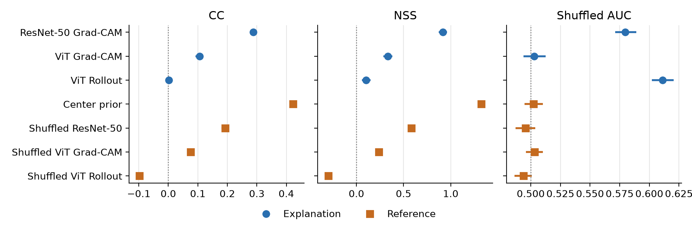

# Human-Machine Attention Alignment on MIT1003

*[TEAM: add names and student IDs]*

## Background: Explanations and Alignment Metrics

---

### 1. What are Grad-CAM and Attention Rollout?

Both methods answer the same question: which part of the input is highlighted as important for the model's decision? They work differently because they target different kinds of models. Both give a heatmap over the input, but a heatmap is only an approximation of what a model relies on. It is not proof of the model's reasoning.

#### Grad-CAM (Selvaraju et al.)

**Brief:** Imagine a panel of judges, each watching for a different clue. Grad-CAM asks which judges' opinions mattered most for the verdict, then shows where those judges were looking.

Say a model looks at a photo and answers "dog." We want to know which part of the photo supported that answer.

**Steps:**
1. The last convolutional layer of a CNN has many feature maps. Each one is a small grid that lights up where it detects something, such as ears, fur or a snout.
2. Ask the model how much the "dog" score would change if each feature map were nudged a little. That sensitivity is the gradient.
3. Feature maps that strongly affect "dog" get a large weight, and the others get a small one.
4. Add up the feature maps using those weights. Overlay the result on the photo, and the hot spots show where Grad-CAM finds evidence for "dog."

#### Attention Rollout (Abnar and Zuidema)

**Brief:** Attention Rollout is like following a rumor back through a chain of people to find who started it.

A Vision Transformer splits an image into patches. In each layer, every patch attends to other patches and passes information around, so each layer's attention map shows who listened to whom.

By the last layer, information has been mixed many times. Looking only at the last layer is misleading, because patch A may have received its information from patch B, which received it from patch C two layers earlier. Attention Rollout fixes this by multiplying the attention maps layer by layer and accounting for the skip connections. The result estimates how much each original patch influences the final output.

#### Quick comparison

| | Grad-CAM | Attention Rollout |
|---|---|---|
| Works on | CNNs, and can be adapted to others | Transformers |
| Uses | Gradients and feature maps | Attention weights only |
| Specific to one class? | Yes, it can ask "why dog?" | No, it shows general importance |
| Needs backpropagation? | Yes | No |

---

### 2. CC (Pearson correlation)

**Brief:** Lay two heatmaps side by side. CC asks whether they get hot and cold in the same places.

- CC = 1 means the two patterns move together perfectly.
- CC = 0 means there is no linear relationship.
- CC = −1 means one map is hot exactly where the other is cold.

Higher is better. CC needs a continuous human map, so it depends on how much the fixation points were blurred.

---

### 3. NSS (Normalized Scanpath Saliency)

**Brief:** Standardize the model's heatmap, then look only at the exact spots where people looked. NSS is the average heat at those spots.

- NSS above 0 means the map is hotter than its own average at the places people looked.
- NSS near 0 means the map does no better than a flat guess.
- NSS below 0 means the map is colder than average at those places.

Higher is better. NSS uses the raw fixation points, so the human map's blur does not affect it.

---

### 4. SIM (similarity)

**Brief:** Picture two piles of sand on the same floor. SIM asks how much sand sits in the same places in both piles.

SIM treats each map as a distribution of attention. It is also called histogram intersection, the same min-and-sum idea used to compare color histograms.

**Steps:**
1. Normalize both maps so that each one adds up to 1. Each map is now a pile of sand with the same total amount.
2. At each pixel, take the smaller of the two values.
3. Add up all those smaller values. The sum is SIM.

SIM = 1 means the maps are identical, and SIM = 0 means they do not overlap at all. Higher is better.

SIM punishes both kinds of mistake. A map that is hot where humans did not look loses overlap, and so does a map that misses where humans did look. CC cares about matching patterns, while SIM cares about matching the actual amount at each location.

---

### 5. KL divergence

**Brief:** Imagine betting on where people will look, using the model's map as your belief. KL is how much extra surprise you suffer because your belief differs from what people really did.

KL compares two distributions, but it is not a true distance because it is not symmetric. In saliency work, the human map P is usually treated as the truth and the model's map Q as the guess. Both are normalized to add up to 1.

$$KL(P\|Q) = \sum P \cdot \log\left(\frac{P}{Q}\right)$$

**Steps:**
1. At each pixel, compare the human value P with the model value Q.
2. If humans looked there a lot but the model says almost nothing is there, the penalty is large.
3. If P and Q roughly agree, the penalty is small.
4. Add up the penalties over all pixels.

KL = 0 means the maps are identical. A higher KL means more mismatch, so **lower is better**, the opposite of CC, NSS and SIM.

KL has three quirks. KL(P‖Q) is not equal to KL(Q‖P). It punishes misses heavily, because a place people looked at that the model scores near zero makes the value blow up. It is also sensitive to zeros, so implementations add a tiny constant to avoid dividing by zero.

---

### 6. AUC-based saliency measures

**Brief:** Treat the heatmap as a detector. Pick one spot people looked at and one spot they did not. AUC is the chance that the heatmap is hotter at the spot people looked at.

**Steps:**
1. Treat pixels where humans fixated as positives and the other pixels as negatives.
2. Pick a threshold. Everything hotter than it counts as predicted attention.
3. Measure the true positive rate, the share of real fixations the map caught, and the false positive rate, the share of negatives it wrongly flagged.
4. Sweep the threshold from hottest to coolest and plot the two rates against each other. This is the ROC curve, and AUC is the area under it.

AUC = 1 is perfect, AUC = 0.5 is chance, and a value below 0.5 is worse than random.

AUC only cares about ranking, hotter versus cooler, so it is robust to scaling and contrast. The same property makes it weaker at judging fine detail, since a map only needs the right order and not the right amounts.

The main variants differ in where the negatives come from.

| Variant | Negatives | Note |
|---|---|---|
| AUC-Judd | All non-fixated pixels in the image | Simple, but a blurry or center-biased map can look good |
| AUC-Borji | Randomly sampled pixels, repeated and averaged | Similar in spirit to AUC-Judd |
| Shuffled AUC, or sAUC (Zhang et al.) | Fixations taken from other images | Discounts center bias |

People tend to look near the center of an image regardless of its content (Tatler). In shuffled AUC, the negatives share that habit, so a map must do better than guessing the center to score well (Bylinskii et al.).

---

### Summary comparison

| Metric | Better when | Compares | Plain question |
|---|---|---|---|
| CC | Higher | Map vs. map | Do the patterns move together? |
| SIM | Higher | Map vs. map | How much do they overlap? |
| KL | Lower | Map vs. map | How surprised am I by the truth, given my map? |
| NSS | Higher | Map vs. fixations | Is the map hot where people looked? |
| AUC | Higher | Map vs. fixations | Can the map separate fixated from non-fixated pixels? |

---

### How this maps onto our project

| Item | In our setup |
|---|---|
| Grad-CAM | Used on ResNet-50 and on ViT-B/16 |
| Attention Rollout | Used on ViT-B/16 |
| CC | Main metric |
| NSS | Main metric |
| Shuffled AUC | Supplementary metric, used as a check on center bias |
| SIM, KL, AUC-Judd, AUC-Borji | Described for background, not used in our results |

## 1. Dataset and Model

We ask one question: **does a vision model rely on the same visual evidence that people look at?**

**Brief:** Record where people look at a photo. Ask a trained model to name the same photo, and ask an explanation method which parts it highlights for that answer. Then measure how well the two sets of places match.

**Human attention.** We use MIT1003 (Judd et al.), where 15 people freely viewed 1003 natural photos while an eye tracker recorded where they looked. Its fixation maps use each person's top six fixations, so they describe early attention. We use all 1003 photos. The dataset has no class labels or content labels.

**Models.** We use two pretrained ImageNet classifiers from `timm` (Wightman). One is ResNet-50 (He et al.), `resnet50.tv2_in1k`. The other is ViT-B/16 (Dosovitskiy et al.), `vit_base_patch16_224.augreg2_in21k_ft_in1k`.

**Explanations.** We use three explainers, always for the model's own top answer. Grad-CAM comes from the `pytorch-grad-cam` package (Gildenblat et al.).

| Explainer | Model | Why we include it |
|---|---|---|
| ResNet-50 Grad-CAM | ResNet-50 | The CNN baseline |
| ViT Grad-CAM | ViT-B/16 | Same method as above, different architecture |
| ViT Rollout | ViT-B/16 | Same model as above, different method |

We treat these maps as descriptions of what each method highlights, not as a full account of how the model reasons.

## 2. Experimental Setup

**Brief:** Before comparing two heatmaps, they must be on the same sheet of paper. We put every human map and every model map on the same 224×224 grid, then score them with the same code.

**Steps:**
1. Resize the whole photo to 224×224 and give it to the model. We do not center-crop, because cropping removes places people really looked at.
2. Build the human map. Blur the fixation points at full resolution with a Gaussian, then shrink the map to 224×224 by area averaging. The dataset does not document its blur, so we fitted σ = 24 pixels to its own fixation maps (mean CC 0.99986 over all 1003 images).
3. Scale the fixation points to the same 224×224 grid.
4. Compute each explanation. Grad-CAM explains the top answer's score before softmax and keeps only positive evidence. Rollout averages the attention heads and discards nothing.
5. Stretch each explanation to 224×224 with bilinear interpolation. ResNet-50 maps start at 7×7 and ViT maps start at 14×14.
6. Score each map with CC, NSS and shuffled AUC. We apply no thresholds. A constant map would count as undefined, and none occurred.

**Why three metrics?** People tend to look near the center of an image (Tatler), and CC and NSS reward a map for matching that general habit. Shuffled AUC discounts it (Bylinskii et al.). Using all three separates agreement about this particular image from agreement about where people usually look.

**Three reference maps.** A score alone is hard to read, so we compare each explanation with three reference points.

| Reference | What it is | What it tells us |
|---|---|---|
| Center prior | The average human map of all other photos | Does the explanation beat always guessing where people usually look? |
| Shuffled pairing | The explanation scored against another photo's human data | How high is the score with no match to this photo? |
| Grid limit | The human map passed through the explanation's own grid | What is the best score that grid allows? |

**Brief on the grid limit:** A 7×7 grid is like painting with a very wide brush. Even a perfect painter loses detail. On our data, the 7×7 grid caps mean CC at about 0.79, and the 14×14 grid caps it at about 0.94. To compare the models fairly, we also reduce ViT maps to 7×7.

**Statistics.** Intervals are 95% bootstrap intervals over images. Paired comparisons use Wilcoxon signed-rank tests, with Holm correction because we run many tests.

**Reproducibility.** Code, scores and scripts are in our repository. Reported numbers come from one full run on Apple MPS. On 20 photos, CPU and MPS gave identical top answers and scores that differed by at most 0.00002.

## 3. Quantitative Alignment

**Brief:** Overall, the explanations do not match human attention well. A map that ignores the photo and just favors the center beats all of them on two of our three metrics.

| Map | CC | NSS | Shuffled AUC |
|---|---|---|---|
| ResNet-50 Grad-CAM | 0.288 (0.276, 0.300) | 0.917 (0.874, 0.960) | 0.580 (0.571, 0.589) |
| ViT Grad-CAM | 0.106 (0.093, 0.119) | 0.334 (0.285, 0.382) | 0.503 (0.494, 0.512) |
| ViT Rollout | 0.002 (−0.010, 0.014) | 0.104 (0.058, 0.152) | 0.611 (0.602, 0.621) |
| Center prior | 0.422 (0.413, 0.433) | 1.326 (1.293, 1.363) | 0.502 (0.495, 0.510) |
| Grid limit, 7×7 | 0.786 | 2.616 | 0.800 |
| Grid limit, 14×14 | 0.941 | 3.408 | 0.862 |

*Table 1. Mean alignment over 1003 photos, with 95% intervals.*

*Figure 1. Mean alignment with 95% intervals. Dotted lines mark 0 for CC and NSS, and chance (0.5) for shuffled AUC.*

**The center beats every explanation on CC and NSS.** A map that ignores the photo reaches CC 0.422, against 0.288 for the best explanation (paired difference −0.135, Holm p < 0.001). On shuffled AUC, the center prior is at chance, while ResNet-50 Grad-CAM (0.580) and Rollout (0.611) are above it. ViT Grad-CAM (0.503) cannot be told apart from the center prior or from its own shuffled pairing on that metric (Holm p = 0.99).

**The metrics rank the explainers differently.** Rollout is lowest on CC and NSS but highest on shuffled AUC. Its maps correlate negatively with the center prior (mean CC −0.221, negative on 82% of photos), compared with +0.462 for ResNet-50 Grad-CAM. CC and NSS penalize that off-center placement, and shuffled AUC discounts it.

**Grid size does not explain the gap between models.** ViT Grad-CAM reduced to 7×7 reaches CC 0.141, still below ResNet-50 Grad-CAM (difference 0.147, Holm p < 0.001).

**Alignment changes with image content.**

**Brief:** For each explainer, compare how it does on photos with a certain property against how it does on all the other photos. A negative number means that kind of photo is harder for that explainer than usual.

Categories come only from the photo or the human data, never from the explanation being judged. They are faces (YuNet; Wu et al.), text (EasyOCR, which uses CRAFT; Baek et al.), small salient attention, edge or texture-rich photos, and peripheral attention. The score is each explainer's own percentile, combining CC and NSS.

| Explainer | Category | Inside minus outside | Photos inside |
|---|---|---|---|
| ViT Rollout | Text | −0.189 | 180 |
| ResNet-50 Grad-CAM | Faces | −0.176 | 274 |
| ViT Grad-CAM | Faces | −0.128 | 274 |
| ViT Rollout | Edge or texture-rich | −0.107 | 201 |
| ResNet-50 Grad-CAM | Text | −0.096 | 180 |
| ResNet-50 Grad-CAM | Edge or texture-rich | −0.082 | 201 |
| ViT Rollout | Small salient | +0.184 | 201 |

*Table 2. Category effects that survive Holm correction across 15 tests. Rollout on faces is +0.008 and not significant. These are associations. In a visual check of 20 sampled photos per detector, detected faces looked correct and about three-quarters of the text flags showed real text.*

**Occlusion.**

**Brief:** Cover a region of the photo and see how much the model's confidence falls. If covering a region hurts a lot, the model depends on that region.

We masked the top 20% of each map and measured the fall in the top answer's probability. Grad-CAM regions lower confidence more than human-attended regions, and human-attended regions lower it more than random regions of the same size. Rollout regions are close to random and below human regions, even though Rollout has the best shuffled AUC. As a sanity check (Adebayo et al.), maps from randomly initialized models were unrelated to maps from the trained models (mean Spearman within ±0.021, 100 photos).

| Model | Human region | Grad-CAM region | Rollout region | Random region |
|---|---|---|---|---|
| ResNet-50 | 0.122 / 0.117 | 0.147 / 0.142 | n/a | 0.084 / 0.087 |
| ViT-B/16 | 0.240 / 0.246 | 0.333 / 0.341 | 0.177 / 0.173 | 0.152 / 0.177 |

*Table 3. Mean fall in top answer probability over 1003 photos, with blur fill / mean-color fill.*

**Center cropping.** On 200 photos resized to 256 and center-cropped to 224, which keeps 89.8% of fixations on average, the three explainers keep their order on every metric and the center prior stays first on CC and NSS.

## 4. Misalignment Cases

**[TEAM TO WRITE the explanation for each case. Everything below is evidence, not explanation.]**

We chose cases by measurement, not by appearance. For each Holm-significant category effect, we took the photo with the largest gap between the two explainers, leaving out the 5% of photos with the fewest fixations.

*Figure 2. Input, human attention and the three explanations, with each model's top answer and scores. Maps are scaled for display.*

| # | Category | Weak, then better fit | Top answer (weak model) | Weak CC / NSS / sAUC | Better fit CC / NSS / sAUC | Occlusion fall, blur (own / human / random) | Occlusion fall, mean color (own / human / random) | Starting probability |
|---|---|---|---|---|---|---|---|---|
| 1 | Faces | ResNet Grad-CAM, then Rollout | mountain bike | −0.10 / −0.38 / 0.22 | 0.40 / 1.66 / 0.73 | 0.309 / 0.204 / 0.197 | 0.309 / 0.284 / 0.232 | 0.313 |
| 2 | Text | Rollout, then ViT Grad-CAM | menu | −0.34 / −1.38 / 0.21 | 0.53 / 2.15 / 0.78 | 0.071 / 0.223 / 0.120 | 0.030 / 0.222 / 0.150 | 0.223 |
| 3 | Edge or texture | Rollout, then ViT Grad-CAM | mask | −0.19 / −0.56 / 0.42 | 0.49 / 1.45 / 0.69 | −0.058 / 0.581 / 0.079 | −0.077 / 0.695 / 0.112 | 0.746 |
| 4 | Small salient | ViT Grad-CAM, then Rollout | lakeside | −0.16 / −0.65 / 0.26 | 0.34 / 1.48 / 0.84 | 0.286 / −0.233 / −0.009 | 0.112 / 0.100 / 0.126 | 0.602 |
| 5 | Faces | ViT Grad-CAM, then Rollout | stage | −0.23 / −0.87 / 0.22 | 0.27 / 1.01 / 0.81 | 0.147 / −0.273 / −0.027 | 0.199 / −0.342 / −0.078 | 0.333 |

*Table 4. Case evidence. Occlusion values are for the weak explainer's model. In case 4 the human-mask result changes sign between fills, so occlusion is not reliable there.*

For each case, explain what the human and the model appear to prioritize, and why. The brief suggests background context, object texture, edges, small salient objects, faces, text, contextual shortcuts or task-irrelevant regions. Note whether the case suggests a shortcut (Geirhos et al.) or a failure of perceptual alignment.

- **Case 1.** [TEAM]
- **Case 2.** [TEAM]
- **Case 3.** [TEAM]
- **Case 4.** [TEAM]
- **Case 5.** [TEAM]

## 5. Discussion

**[TEAM TO WRITE using the evidence below. Answer this question: is the model using visual evidence that is consistent with human attention?]**

Available evidence:

- **Content.** Table 2 shows that faces lower both Grad-CAM maps but not Rollout.
- **Model correctness, through proxies only.** Higher confidence goes with slightly better CC and NSS for ResNet-50 Grad-CAM (rho 0.12 and 0.11) and ViT Grad-CAM (0.19 and 0.17), and not reliably for Rollout. Where ResNet-50 and ViT give the same top answer (47% of photos), ViT Grad-CAM aligns better (+0.054, Holm p = 0.010).
- **Salient objects and attention spread.** Broader human attention goes with worse Rollout scores (CC rho −0.44, NSS −0.38, shuffled AUC −0.30).
- **Plausible maps can mislead.** Rollout has the best shuffled AUC, but covering its regions is close to covering random regions (Table 3).
- **Limitations to choose from.** Observers had no classification task. The maps show early fixations only. There are no labels for correctness or content. The detectors are imperfect. Occlusion produces unnatural images. ImageNet classes fit many scenes poorly, and the two models often explain different answers.
- **Possible follow-up experiments.** Task-driven eye tracking on the same photos, adding labels for correctness and content, or comparing other explainers or a CLIP encoder.

## Contribution Statement

*[TEAM TO WRITE each member's role. Excluded from the page limit.]*

## Works Cited

Abnar, Samira, and Willem Zuidema. "Quantifying Attention Flow in Transformers." *Proceedings of the 58th Annual Meeting of the Association for Computational Linguistics*, 2020, pp. 4190–97, https://doi.org/10.18653/v1/2020.acl-main.385.

Adebayo, Julius, et al. "Sanity Checks for Saliency Maps." *arXiv*, 2018, https://doi.org/10.48550/arXiv.1810.03292.

Baek, Youngmin, et al. "Character Region Awareness for Text Detection." *2019 IEEE/CVF Conference on Computer Vision and Pattern Recognition*, 2019, pp. 9357–66, https://doi.org/10.1109/CVPR.2019.00959.

Bylinskii, Zoya, et al. "What Do Different Evaluation Metrics Tell Us About Saliency Models?" *IEEE Transactions on Pattern Analysis and Machine Intelligence*, vol. 41, no. 3, 2019, pp. 740–57, https://doi.org/10.1109/TPAMI.2018.2815601.

Dosovitskiy, Alexey, et al. "An Image Is Worth 16x16 Words: Transformers for Image Recognition at Scale." *arXiv*, 2020, https://doi.org/10.48550/arXiv.2010.11929.

Geirhos, Robert, et al. "Shortcut Learning in Deep Neural Networks." *Nature Machine Intelligence*, vol. 2, no. 11, 2020, pp. 665–73, https://doi.org/10.1038/s42256-020-00257-z.

Gildenblat, Jacob, et al. *PyTorch Library for CAM Methods*. *GitHub*, github.com/jacobgil/pytorch-grad-cam.

He, Kaiming, et al. "Deep Residual Learning for Image Recognition." *2016 IEEE Conference on Computer Vision and Pattern Recognition*, 2016, pp. 770–78, https://doi.org/10.1109/CVPR.2016.90.

Jaided AI. *EasyOCR*. *GitHub*, github.com/JaidedAI/EasyOCR.

Judd, Tilke, et al. "Learning to Predict Where Humans Look." *2009 IEEE 12th International Conference on Computer Vision*, 2009, pp. 2106–13, https://doi.org/10.1109/ICCV.2009.5459462.

Selvaraju, Ramprasaath R., et al. "Grad-CAM: Visual Explanations from Deep Networks via Gradient-Based Localization." *International Journal of Computer Vision*, vol. 128, no. 2, 2020, pp. 336–59, https://doi.org/10.1007/s11263-019-01228-7.

Tatler, Benjamin W. "The Central Fixation Bias in Scene Viewing: Selecting an Optimal Viewing Position Independently of Motor Biases and Image Feature Distributions." *Journal of Vision*, vol. 7, no. 14, 2007, p. 4, https://doi.org/10.1167/7.14.4.

Wightman, Ross. *PyTorch Image Models*. *GitHub*, github.com/huggingface/pytorch-image-models.

Wu, Wei, et al. "YuNet: A Tiny Millisecond-Level Face Detector." *Machine Intelligence Research*, vol. 20, no. 5, 2023, pp. 656–65, https://doi.org/10.1007/s11633-023-1423-y.

Zhang, Lingyun, et al. "SUN: A Bayesian Framework for Saliency Using Natural Statistics." *Journal of Vision*, vol. 8, no. 7, 2008, p. 32, https://doi.org/10.1167/8.7.32.
